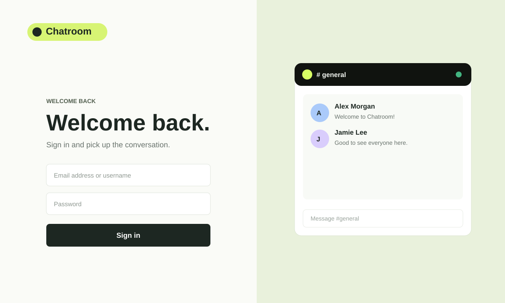
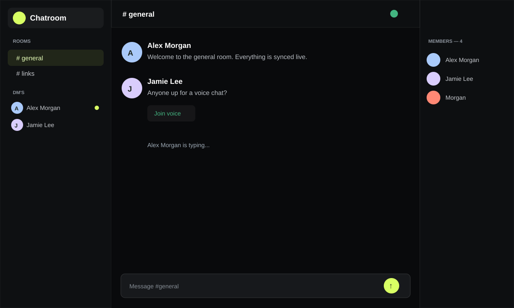
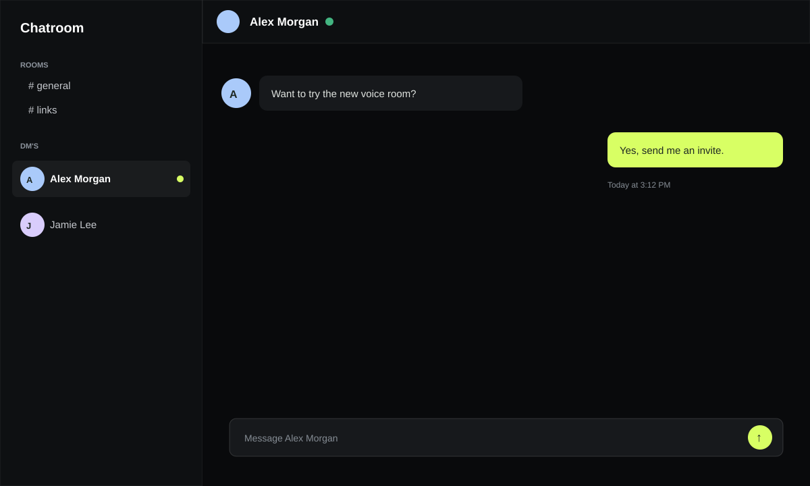
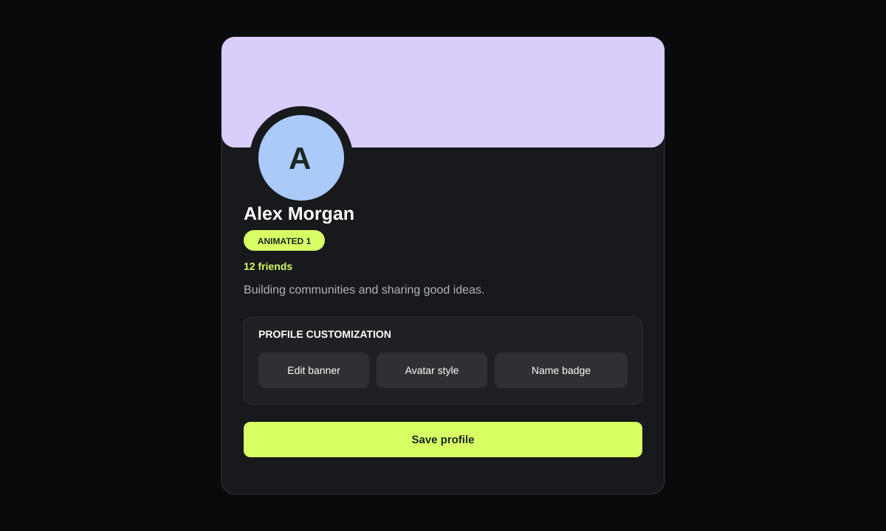

# Obsidian Chat

Obsidian Chat is a real-time, Discord-inspired chat application with a custom theme. It combines public rooms, direct messages, profiles, GIFs, avatar decorations, voice rooms, friends, reactions, replies, uploads, and moderation in one lightweight Node.js app.

## Screenshots

### Sign in and account creation



The account screen supports account creation, sign-in, and automatic session restoration. Existing sessions are reopened by `/api/me`, so returning users do not need to sign in again while their session is valid.

### Main chat layout



The Discord-style layout contains a room and DM sidebar, a live conversation panel, and a member list. Room messages auto-scroll to the newest message immediately and also respond to images, GIFs, attachments, and resized layouts.

### Direct messages



Only real conversation participants appear in **DM's**. Unread DMs display a lime dot, and DM notifications are delivered over Socket.IO. Clicking an avatar opens its profile, where **Message** starts or resumes that conversation.

### Profile, friends, and customization



Profiles display avatars, animated decorations, profile banners, badges, bios, roles, friend counts, friend-request controls, and moderation actions. Owners and moderators can promote, demote, or mute users from the profile dialog.

## Features

| Component | What it does |
|---|---|
| Public rooms | Switch between text rooms, send live messages, mention users, reply, react, and share GIFs or attachments. |
| Direct messages | Open private conversations from avatars, profile cards, or the dedicated DM sidebar. |
| Typing indicators | Show animated `<username> is typing...` activity for rooms and direct conversations. |
| Profile cards | Click any avatar to view a banner, avatar, name badge, bio, live friend count, and available profile actions. |
| Banners and avatars | Use **Choose profile banner** to upload JPG, PNG, WebP, or GIF files, or **Explore banner animations** to select from the labeled animation catalog. |
| Avatar studio | Preview and preload effects, purchase decorations with coins, and use clearly labeled **Use**, **Get**, or **Keep current** actions. |
| Decoration names | Avatar decorations use readable item names derived from their source artwork instead of generic numbered collection labels. |
| Customization categories | Avatar Studio separates items into **Avatar Decorations**, **Banner Decorations**, and **Badges** so each catalog is easy to browse. |
| Warning moderation bot | Integrated keyword-rule warnings track warning counts and post BOT notices; three warnings automatically trigger a 10-minute mute. Owners and moderators retain manual mute controls. |
| Friends | Send friend requests, receive notifications, then accept or decline requests. Accepted friends update both profiles' friend counts. |
| Voice rooms | Join real-time voice rooms with WebRTC and configurable STUN/TURN servers. |
| Moderation | Owner and moderator roles can manage moderators and apply timed user mutes with reasons. |
| Image safety | Image uploads are blocked if moderation is unavailable or rejects the submitted image. |
| Auto-login | A valid Express session restores the signed-in user automatically when the page reloads. |
| Mobile layout | The menu button opens and closes the sidebar, with responsive room, profile, and DM views. |

## Deploy

These buttons deploy the repository. Obsidian Chat uses Socket.IO and JSON-file storage, so every deployed instance should use one persistent process and a persistent data disk. SQLite, Redis, or another shared session store is recommended before scaling to multiple processes.

| | | |
|:---:|:---:|:---:|
| <a href="https://render.com/deploy?repo=https%3A%2F%2Fgithub.com%2FJooshyuah%2FChatroom"><strong>Deploy to Render</strong></a> | <a href="https://railway.com/new/template?template=https%3A%2F%2Fgithub.com%2FJooshyuah%2FChatroom"><strong>Deploy on Railway</strong></a> | <a href="https://github.com/Jooshyuah/Chatroom/blob/main/Dockerfile"><strong>View Dockerfile</strong></a> |

### Render

`render.yaml` configures the web service, persistent chatroom data under `/data`, a generated session secret, and one free web process. The persistent disk keeps users, rooms, messages, avatars, banners, and attachments across deploys.

### Railway or any Docker host

```sh
docker build -t chatroom .
docker run --rm -p 4173:4173 \
  -e SESSION_SECRET="$(openssl rand -hex 32)" \
  -v chatroom-data:/data \
  -e CHATROOM_DATA_PATH=/data/chatroom.json \
  chatroom
```

Mount `/data` as persistent storage. Expose the container on port `4173`.

## Run locally

Requirements:

- Node.js 18 or newer
- npm

```sh
npm install
npm start
```

Open [http://localhost:4173](http://localhost:4173).

The app stores chat state in `data/chatroom.json` by default. Uploaded avatars, banners, and attachments are stored below `data/`, while source assets and GIF catalogs are served from `public/`.

Passwords are stored as salted scrypt hashes. The default Owner name is `Joshua Boudreau`; set `CHATROOM_OWNER_EMAIL` to designate another account by email.

```sh
npm test
```

## Environment variables

| Variable | Default | Purpose |
|---|---|---|
| `PORT` | `4173` | HTTP and Socket.IO listening port. |
| `SESSION_SECRET` | Development fallback | Unique secret used to sign login sessions. |
| `CHATROOM_DATA_PATH` | `data/chatroom.json` | Persistent JSON data location. |
| `CHATROOM_OWNER_EMAIL` | None | Email of the account assigned the Owner role. |
| `CHATROOM_IMAGE_MODERATION_URL` | None | Endpoint receiving raw image bytes for moderation approval. |
| `CHATROOM_IMAGE_MODERATION_KEY` | None | Optional bearer key for the moderation service. |
| `CHATROOM_GATEWAY_TOKEN` | None | Secret header required by `/api` and asset requests when set. |
| `CHATROOM_ICE_SERVERS` | Google STUN | JSON array of STUN/TURN entries for voice calls. |

## School or secure-network deployment

Put Obsidian Chat behind a trusted gateway for restricted-network deployments. The gateway must enforce approved IP and device-access rules, strip incoming `X-Chatroom-Gateway-Key` headers, and inject its own secret after access checks.

Set the same high-entropy value on Obsidian Chat:

```sh
CHATROOM_GATEWAY_TOKEN="$(openssl rand -hex 32)"
```

The server checks this header with a timing-safe comparison. In production, do not expose the app port without that gateway.

For voice calls, set a JSON array of STUN/TURN entries:

```sh
CHATROOM_ICE_SERVERS='[{"urls":"turn:turn.example.org:3478","username":"temporary-user","credential":"temporary-credential"}]'
```

Voice requires HTTPS and microphone permission. Prefer short-lived TURN credentials.

For image uploads, provide a moderation endpoint that accepts the raw image body and original `Content-Type`, then returns `{ "safe": true }` or `{ "safe": false }`. Missing, unavailable, or rejected moderation blocks avatar, banner, and chat-image uploads.

The warning bot behavior is inspired by [rickstaa/warnings-discord-bot](https://github.com/rickstaa/warnings-discord-bot). Because that project is a Discord Gateway bot rather than a web-chat service, Obsidian Chat implements its warning-rule concept directly in Socket.IO and Express moderation logic.

## Storage and scaling notes

- The included JSON database and memory session store are intended for local use or a single deployed process.
- Set `SESSION_SECRET` before deployment and keep it stable across restarts.
- Persist the entire data directory or configure `CHATROOM_DATA_PATH` on a durable volume.
- Add a shared database and session store before running multiple replicas.
- Socket.IO voice and message events currently require WebSocket-capable routing in the hosting platform.
- The profanity filter is moderation assistance, not a complete safety guarantee.

## Tests

```sh
npm test
```

The integration suite starts the app on a temporary test port, creates real accounts and sessions, verifies room and DM message delivery over Socket.IO, and checks image moderation failure behavior.
